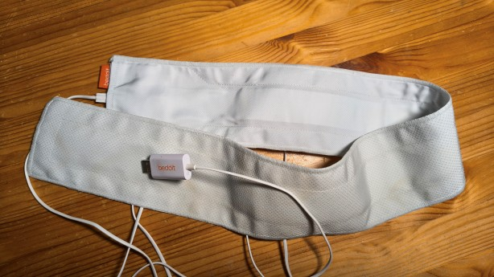

# sleepy

Collect and analyse raw data from a **Beddit B3 / V3 Sensor** sleep
tracker over Bluetooth LE.

## History up until now
Years ago I got Beddit sleep sensor. It is a strip that goes on the bed,
under the person. It looks like this:</br>


Very soon after this Apple bought the company. From what I could see, the
Android app was no longer maintained.</br>I found a
[web page called InMoodForLife that showed how to receive data from the sensor.](https://medium.com/inmoodforlife/beddit-reverse-engineering-c4bdca8e07b8)

I managed to capture Bluetooth packets using Android phone developer mode.
And soon had a command that started measuremement with my version of the tracker.
But I did not know how to process the raw data. Samples arrived in batches.
I likely got both ordering and sample rate wrong, and my filtering
did not produce sensible results. Thus, as I often do, I left the
project lie on the corner of a hard drive. Abandoned it like Apple abandoned
Android users.

Recently I wanted to see what will 20€ credit and a Chinese LLM do.
Having never run an agent, I made a separate VLAN in home network,
installed clean Debian in an old laptop, and placed it alone in the VLAN to
run the agent. It has access to internet and Bluetooth. I gave it a description
what I had tried, told it to tell me when to power the sensor on/off, 
and figure out what is needed.

Python code and following sections of this README is written by LLM.
The result of one session.</br>A short 5 minute test gave plausible values for
breathing and heart rate. Longer run failed with connection error early on.
So there is still work to do.

**IMPORTANT** Do not run this without checking the included dependencies
first! There are some libraries that I am not familiar with and have not checked yet.
Some likely for prettifying CLI stuff. And Windows packages for no reason.


## What we know about the sensor

* Identity (Device Information service): manufacturer `Beddit`, model
  `V3 Sensor`, hardware `3.0`, software `1.1/4a2417b`.
* Two data channels, and the sensor **tells you their sample rates**:
  * PCM channel 1: `140.00 Hz` force (`u2force`) - breathing and heartbeat
  * PCM channel 2: `5.00 Hz` force/touch (`u2touch`) - slow load/presence
* Plus standard Temperature and Humidity notifications.
* Start streaming: enable notifications, then write `0x01` to the vendor
  **Control Point** characteristic.

## Install

```sh
uv sync            # creates .venv with bleak, numpy, scipy, matplotlib, typer
```

Bluetooth needs a working BlueZ setup and membership of the `bluetooth` group.

## Usage

```sh
uv run sleepy scan                 # find the sensor (remembers its address)
uv run sleepy info                 # what the sensor says about itself
uv run sleepy gatt                 # dump every service/characteristic/value
uv run sleepy listen -s 30         # short capture, prints decoded packets
uv run sleepy probe-cmd -H 0x0a -w 4 --values 01,00   # experiment with commands
uv run sleepy record -d 480 -o data/raw/test.bin      # long capture w/ watchdog
uv run sleepy analyse data/raw/test.bin --plot out.png
uv run sleepy process data/raw/test.bin               # breathing + heart rate
uv run sleepy report                                  # self contained HTML
```

Output of `process` lands in `data/nights/<name>/`: `metrics.csv` (per epoch
breathing rate, heart rate, movement, load), `summary.json`, `overview.png`.
`report` turns those into a single HTML page per night plus an index.

## How the signal is processed

1. Decode notifications into a uniform 140 Hz series; the per packet sequence
   counter detects loss and the timing fit removes BLE jitter and clock skew.
2. Drop clipped samples (the DC level with a person in bed sits near the rail).
3. Rolling medians separate the slow "load" (in bed?) from posture drift.
4. Breathing: 0.1-0.6 Hz bandpass + 60 s FFT peak, with a confidence score.
5. Heart rate: 0.8-3.5 Hz ballistocardiogram, 20 s windows - harder, always
   reported with confidence.
6. Movement epochs are marked unusable instead of being silently trusted.

## Status

Working: discovery, streaming, recording, decoding, breathing/heart rate
estimation, HTML reports.
Tests: `uv run pytest`.
